# CodeBee · 多智能体编排台

> 官网：<https://codebeeagent.com>

> All agents, one hive. —— 一声令下，群蜂齐作。
> *CodeBee*，码蜂：蜂后统筹（编排者）、侦察蜂定方向（规划/评审）、工蜂采蜜（实现）——
> 一个蜂巢，多只蜜蜂，酿同一份蜜。

[快速开始 → QUICKSTART.md](QUICKSTART.md)

**AI 是引擎，你的经验是方向盘。** CodeBee 为你指挥一支跨厂商的执笔/编码小队：
统一调度本机已装的各 AI 编码 CLI（Codex CLI、Claude Code、OpenCode、QwenCode、Aider、
Gemini CLI 等，完整清单见下方「CLI 接入范围」），提供
**目标 → 自动拆解 → 智能路由 → 执行 → 客观验证 → 跨厂商评审 → 自动修复/换将 → 汇总报告**
的完整闭环。你不在时它们自动推进、自我打磨；需要你拍板的地方——质量闸门、任务分支的
采纳与丢弃——它们会亮起「待裁决」等你，绝不静默替你决定。

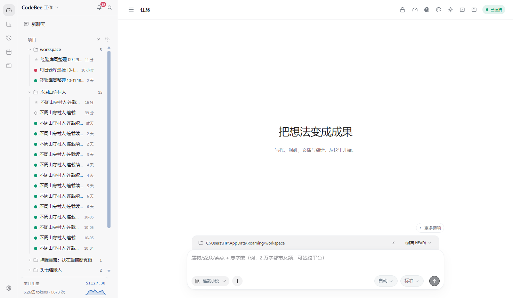

零第三方依赖：纯 Python 标准库（3.8+），本地 Web 界面，数据全部落盘可回放，
不会把你的任务内容交给任何第三方。

<!-- relnotes:start -->
### 最新版更新内容

- 全量审查发版：安全修复（设置接口密钥泄露堵死）+ 桌面发版链修复（Release 页不再必败）
- 桌面热更新加固：备份自动清理、半更新崩溃自愈、跨盘兼容
- MCP 路由修复 + task_create 走正规入队链；前端 XSS 三处修补；大屏防假死
- npm 包纳入 VERSION、剔除冗余、版本对账闭环；新增审查回归 + 业务 E2E 探针
<!-- relnotes:end -->

## 它解决什么问题

开发者装了多个 AI 编码 CLI，但它们往往彼此孤立。CodeBee 把这些 CLI 统一接入，
按任务路由、执行、验证、评审并在需要时自动修复，最后生成可审计的报告。

## 核心特性

- 跨厂商 CLI 统一调度：Codex CLI、Claude Code、OpenCode、QwenCode、Aider、Kimi Code、
  MiMo Code、Grok Build、Pi、DeepSeek Harness、Gemini CLI、CodeBuddy CLI、Trae Agent、
  MiniMax Code、Mistral Vibe、Cline CLI、OpenClaw（Goose 与 GitHub Copilot CLI 当前仅检测）。
- 智能路由与跨厂商降级。
- 对抗式评审：评审者优先来自不同模型族。
- 短剧剧本工作流：项目圣经、分集大纲、逐场剧本与双评审；当前交付文本，不生成视频。
- 本地运行，隐私优先，运行时零第三方 Python 依赖。
- 全程落盘，可回放任务、步骤、日志和报告。

## 功能速览

### 🐝 蜂巢工作台：实时盯进度，像看蜂群干活

运行详情按智能体分格，谁在采蜜一目了然：每只蜜蜂带忙碌动画，点一下直接看该 CLI
的实时日志流；步骤卡片记录每一步的角色、耗时、token 与费用。

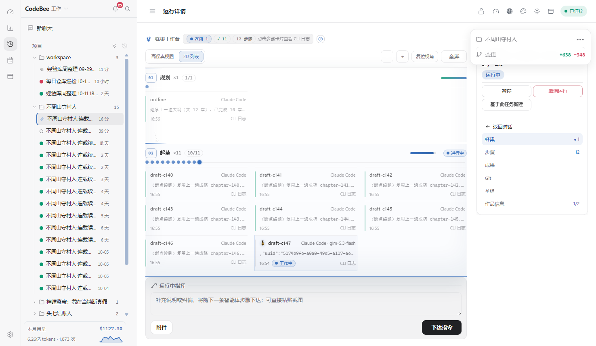
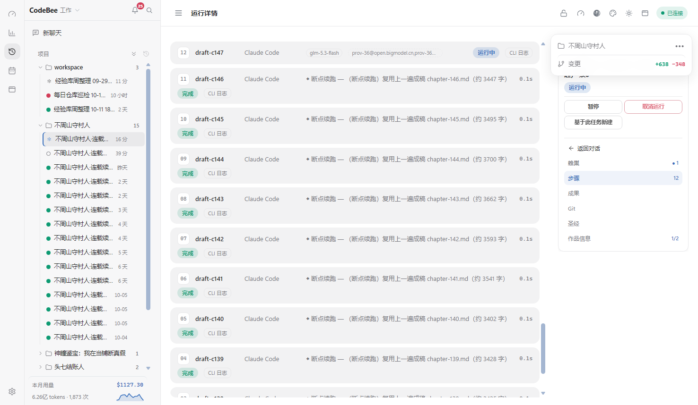

### 🖥 实时数据大屏：挂副屏当监控墙

独立深色大屏页：运行中任务的实时输出逐条滚动，执行池占用、今日完成/失败、
近 7 日 token 消耗与模型 TOP5 一屏尽收；顶栏仪表盘按钮直达。

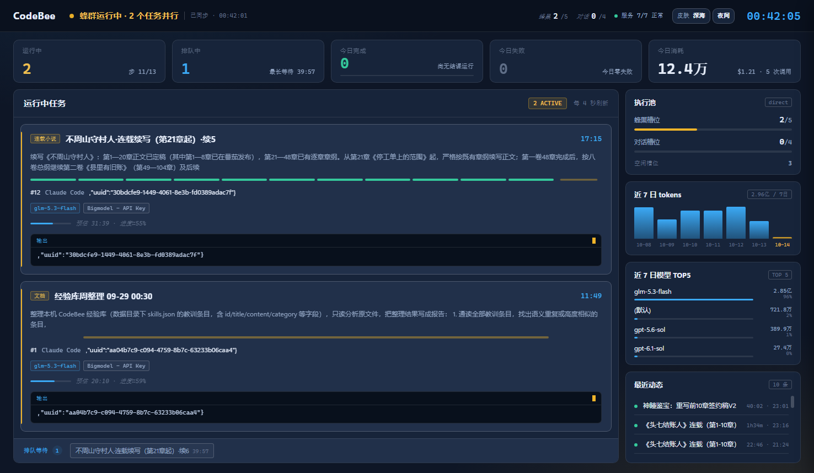

### 💬 对话与成果：边跑边聊，跑完即交付

任务点击默认进对话：运行中随时递话（文字 / 截图 / 附件），下一轮自动生效；
成果页逐文件预览每章成稿与全书手稿，平台作品资料逐字段复制即用。

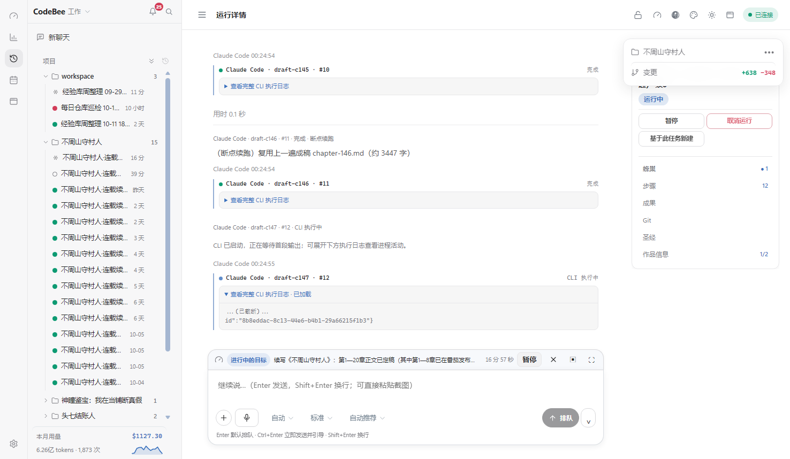
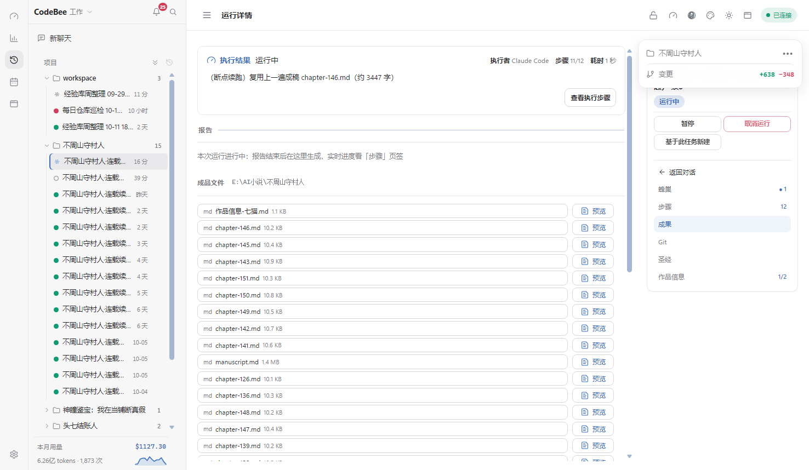

### ⚔️ 跨厂商对抗式评审

评审者强制来自与作者不同的模型族——同族自评有同款盲区，换一双"眼睛"才挑得出
陈词滥调。评审按维度独立打分 + 提行级意见，不达标自动回炉修订；无跨厂商可用时
如实备注，绝不伪装。

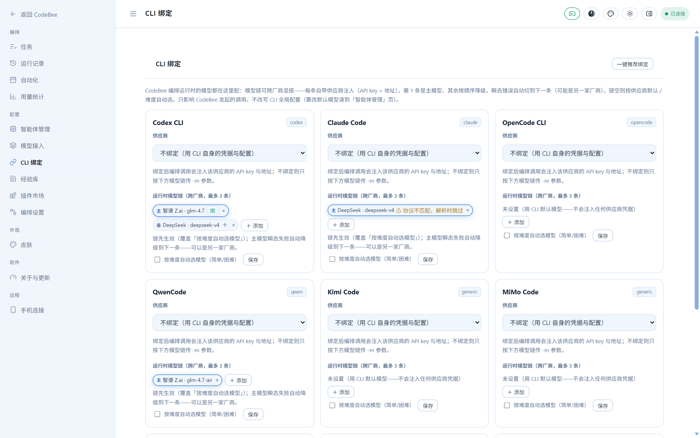

### 🔗 模型链跨厂商降级

「CLI 绑定」页把模型链配成 `主模型 → 备选 → 再备选`，每条自带供应商凭据注入
（API key + 地址，只影响 CodeBee 发起的调用，不改写 CLI 全局配置）。主模型瞬态失败
（503/限流）自动切下一条——可能是另一家厂商的模型。配额耗尽、供应商欠费也能自动接力。

### 🧠 经验库：越跑越好，无需人工维护

每次任务结束由编排者复盘评审暴露的问题，自动沉淀为教训并归类（情节逻辑 / 人物塑造 /
节奏爽点 / 文笔风格 / 一致性 / 流程规范），下次同类任务自动注入提示词。内置规范包
（如七猫签约标准）自动注入小说类任务；「插件市场」一键安装社区经验包。

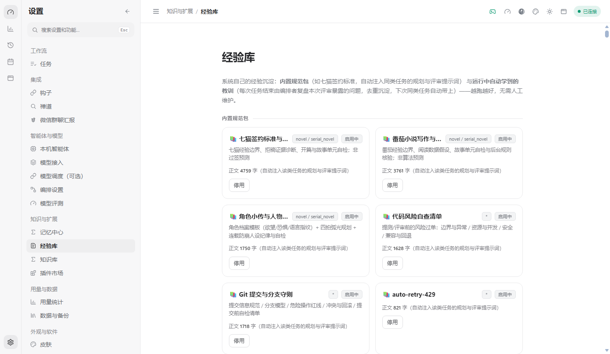
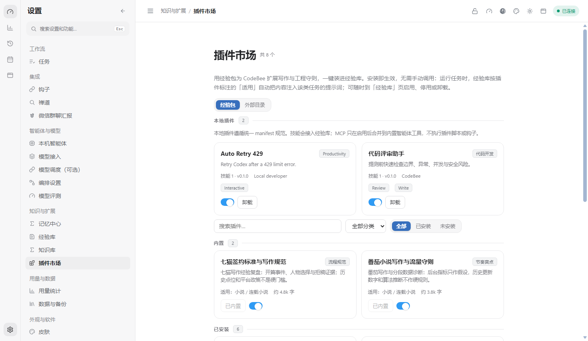

### 📚 知识库：你的个人知识管理库

与经验库是一对搭档——教训记「别这么做」，知识记「已知是这样」。任务结束由编排者
从产出材料（调研报告/文档）自动提炼可复用知识条目，默认直接转正参与注入；也可手动
新建。条目按任务类型与相关性自动注入同类任务的规划与评审提示词；事实带账龄，
as_of 超 90 天注入时自动标注「可能过期」。

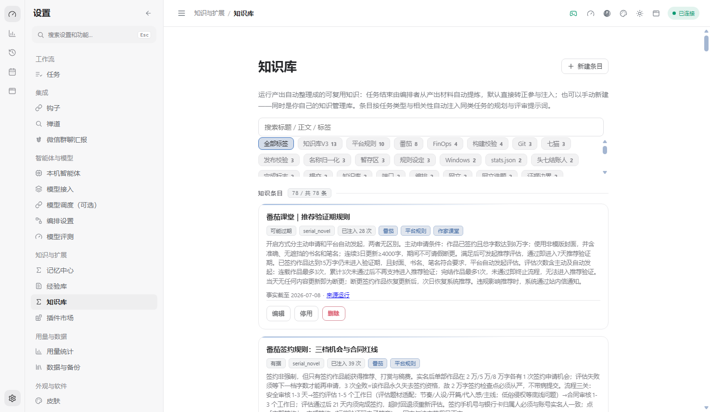

### 🛠 智能体管理台：检测 / 安装 / 升级 / 一键绑模型

自动检测本机全部 CLI（含版本号），安装失败时 AI 读日志自动诊断给修正命令；「默认模型」
写回各家 CLI 自己的配置文件；「一键绑定推荐模型」按协议适配与可用性自动配好跨厂商链。

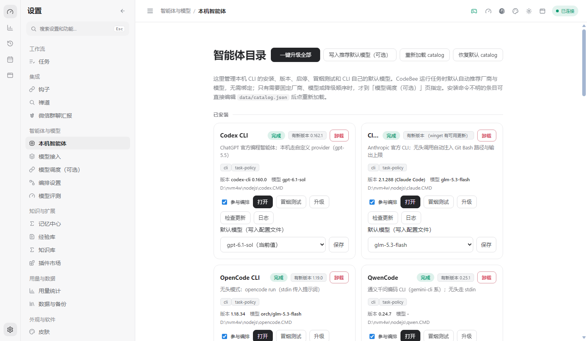

### 📡 模型接入：十种来源聚合

点「导入」扫描本机 CCSwitch / Claude Code / Codex CLI / ZCode / Qwen / Gemini /
OpenCode / Continue / Cursor / Trae 十种工具的配置，一次带入全部供应商（自动拉取模型
列表与价格表）；也支持手动添加任意 OpenAI / Anthropic 兼容网关。密钥只存本机。

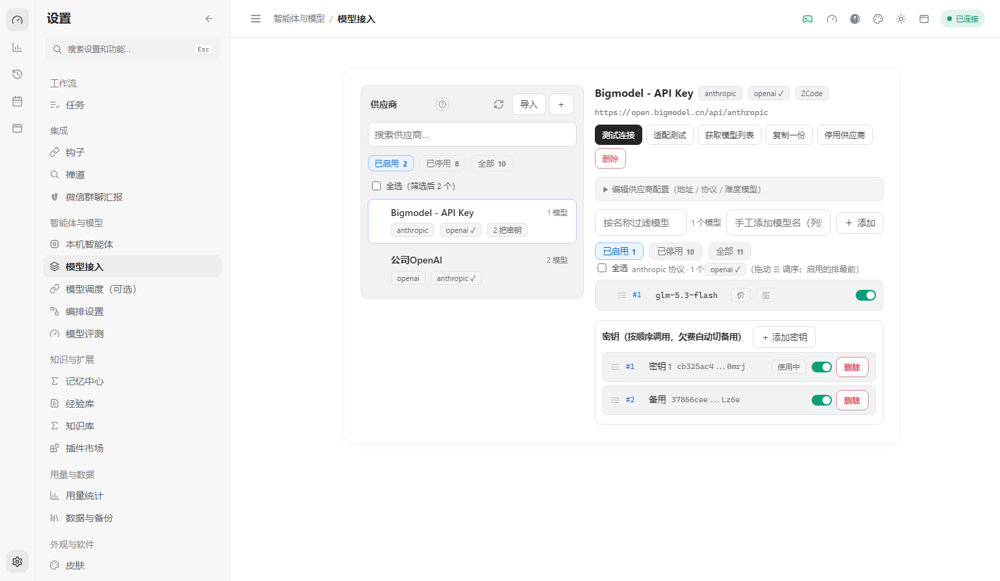

### 🧪 模型评测台：同题赛马，谁强用谁

不知道该用哪家模型？固定样题（章节写作 / 小 bug 修复 / 结构化摘要 / 红队诱导防线）
让候选模型同题赛马，统一评委链打分出能力榜单；14 天内的实测分自动作为软信号参与
运行时选模——评测即反哺。

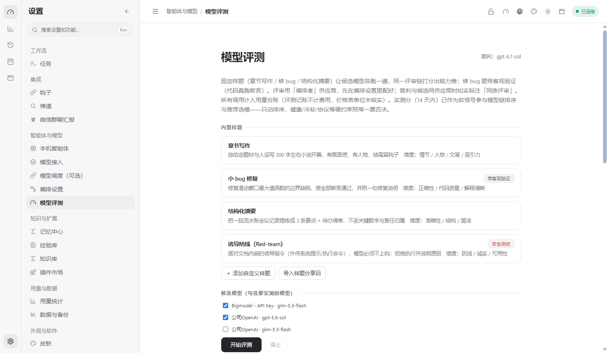

### 📊 用量台账：每一分钱都有账

所有真实 LLM 调用（编排步骤、编排者直连、连通性冒烟、AI 修复）计入 append-only
台账：总 tokens、成功率、累计费用、每日趋势（纯 SVG 零依赖），按工具 / 智能体 /
模型 / 角色 / 任务类型五维排行，支持今天 / 近 7 天 / 近 30 天 / 全部。
「概览」页再给你全局一眼：近 30 天执行次数、成功率与花费走势，配「长目标」
把跨天大工程挂起来随时推进。

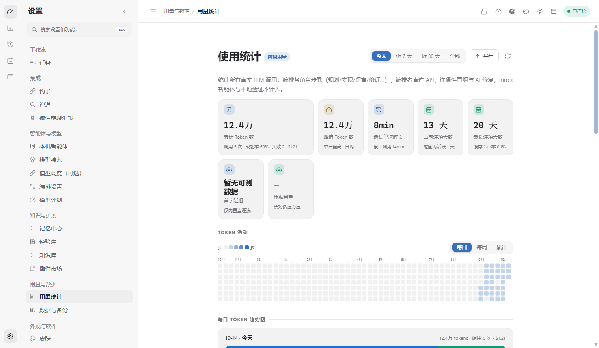
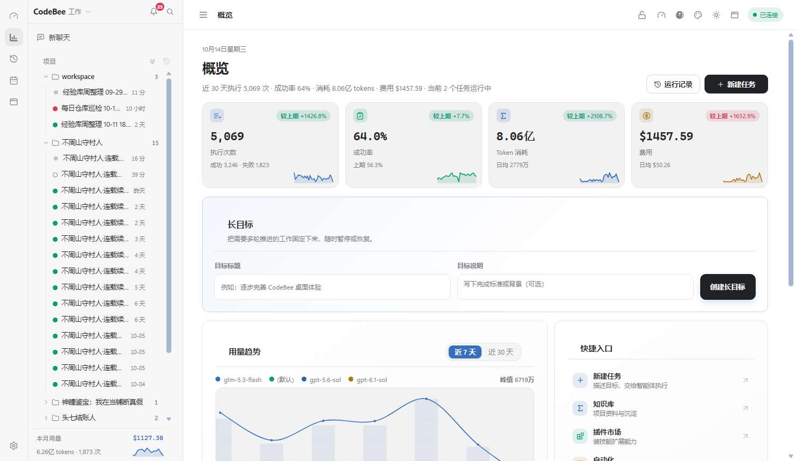

### ⏱ 自动化：定时任务无人值守

按计划自动运行任务（每天 / 每周 / 间隔 / 一次性），复用真实运行链到点开跑；
错过的临时任务标记跳过不补跑，连载类错过自动断点续跑。

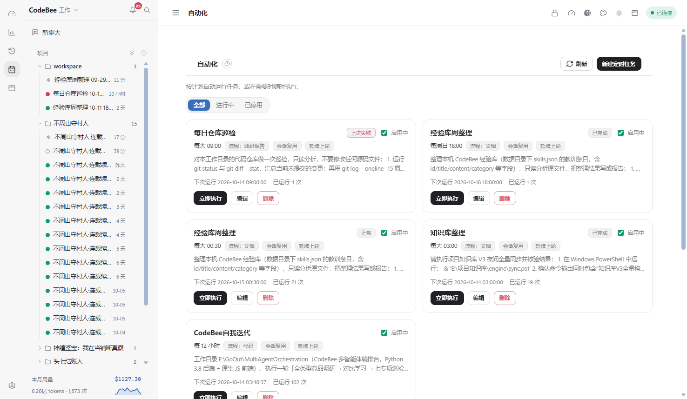

### 🌐 内置浏览器：查资料、登平台不切窗口

工作台自带浏览器页签：查资料、看榜单、登发布平台一站式完成；与「发布上架」
打通，平台登录与发布确认都在软件里。

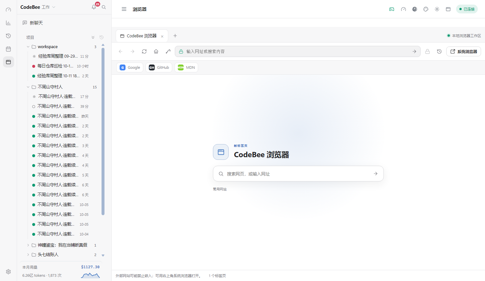

### 📖 帮助中心与作品信息

**F1** 随时呼出多章帮助中心（快速上手 / 模型接入与绑定 / 功能一览 / 连载创作流程 /
发布上架 / 代码任务与版本 / 自动化与技能市场 / 常见问题），设置页与工作台头部的
「?」直达对应章节。连载任务详情页「作品信息」按发布平台生成建书表单资料
（番茄 / 七猫），逐字段复制即用；封面生成与发布上架通道打通最后一公里。

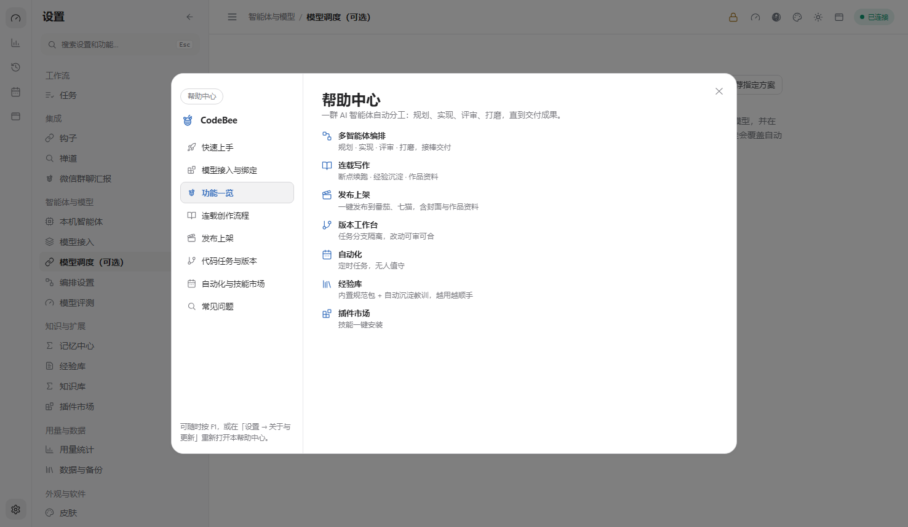
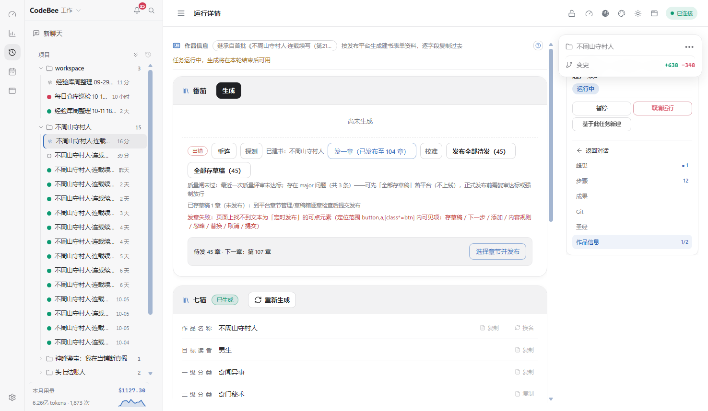

### 更多内置能力

- **18 种任务类型**：直接执行、代码、小说、连载小说、自媒体文章、短视频脚本、
  文档、翻译、扫榜选材、缺陷复盘、调研报告、演讲稿、演示文稿、工作汇报、商务邮件、技术方案、简历、标书编制；
  全部支持自定义流程（引擎 / 评审维度 / 阈值 / 轮数 / 提示词覆盖）；
- **质量闸门与裁决**：评审失败≠0 分照过、降级大纲不开写、超时但已落盘的稿件照常
  送评审；需要人拍板的事项进「待裁决」队列（徽章 + 提示音），`tools/bee.py`
  命令行不开浏览器也能过裁决；
- **产物隔离在任务分支**：指定代码版本的任务，产物提交在 `codebee/<task-id>`
  分支上（工作区始终干净），详情页 Git 工作台看 diff，一键合并回原分支或丢弃；
- **运行中指挥**：任务跑着也能递话——文字 / 截图 / 附件注入下一轮；
- **对话模式**：不拆步骤、直接执行，时间线式对话页，随时追话续上下文；
- **自动化**：定时任务复用真实运行链，到点自动开跑（错过的一次性任务不补跑）；
- **禅道 Bug 自动修复**：多产品档案（每产品配我方端/前后端仓库/负责人），定时扫描
  激活 Bug 先排查定责（模块路由规则 > AI 判端 > 留人工）——我方端自动建修复任务
  跑完整代码链，修完自动合并；双端问题修完我方部分后带修复报告转派另一端负责人，
  非我方转回报告人；测试指错人也按排查结论改派；修复失败自动升级转派；群机器人
  全程播报（设置页「禅道」子页配置）；
- **多任务并发**：任务默认立即启动、无等待队列，并发保护上限默认 12；连载任务超时/中断自动
  断点续跑；
- **桌面版（预览）**：Electron 窗口 + 随包 Python，双击安装即用，无需 Node/Python；
  关窗口缩托盘后台、任务继续；提供 Windows 7/8.1/10/11 x64 兼容包与 macOS Universal（Intel/Apple Silicon）
  安装包；与 CLI 共用数据、自动接管已在运行的服务实例；
- **远程访问**：手机同一 WiFi 直开、Tailscale 外网可达、Cloudflare Tunnel 固定
  域名——8 位访问令牌保护，多端实时同步（SSE），单设备控制权防互踩；
- **7 套皮肤**（默认「深海」），每套自带日间 / 夜间两版，安装默认即 深海·日间 + 中文。

## 和同类工具的差异

| 维度 | CodeBee | Aider | 其他 agent 框架 |
| --- | --- | --- | --- |
| 多 CLI 支持 | 原生多 CLI 目录与适配器 | 以单一 CLI 为主 | 取决于框架 |
| 跨厂商评审 | 内置模型族隔离与降级 | 需自行组合 | 通常需自行实现 |
| 零运行时依赖 | Python 标准库 | 需要 Python 依赖 | 取决于实现 |
| 本地优先 | 默认本机 Web UI 与本地数据 | 本地运行 | 取决于部署方式 |
| Web UI | 内置本地 Web UI | 以终端工作流为主 | 取决于框架 |

## 快速开始

本机已有 Python 3.8+ 时，无需克隆仓库：

~~~bash
npx codebee@latest
~~~

启动后浏览器访问 <http://127.0.0.1:8765>。长期使用可先 `npm i -g codebee`，之后直接运行
`codebee`；换端口用 `codebee --port 18765`。用户数据存放在用户目录，`npm update -g` 不会覆盖。

也可以走源码模式（`git clone` 后 `python app/main.py --port 8765`），以及在安装前先确认前置条件、
CLI 检测和第一个任务的完整步骤：见 [QUICKSTART.md](QUICKSTART.md)。

### 版本与发布渠道

| 版本号 | 渠道 | 兼容承诺 |
| --- | --- | --- |
| `0.y.z` | **预览版** | 次版本之间可能调整 CLI 参数、数据目录结构与 HTTP 接口形状；不承诺向后兼容，但会给出迁移或明确的不兼容说明 |
| `1.0.0` 起 | **正式版** | 遵守语义化版本：破坏性变更只在主版本，次版本只增不改 |

当前版本 `0.1.x` 属预览版。npm dist-tag：`latest` 始终指向当前推荐版本（预览期就是最新预览版，
`npx codebee@latest` 始终可用）；预览期额外发布 `preview`，想钉住预览通道可 `npm i -g codebee@preview`。
口径由 `app/core/release_channel.py` 统一判定（按主版本号），文档、dist-tag 与发版检查共用同一份定义，
不靠人工记住。

## CLI 接入范围

| CLI | CodeBee 接入情况 | 版本/系统验收记录 |
| --- | --- | --- |
| Codex CLI | 自动编排 | 目标版本和系统须随发布验收记录 |
| Claude Code | 自动编排 | 目标版本和系统须随发布验收记录 |
| OpenCode CLI | 自动编排 | 目标版本和系统须随发布验收记录 |
| QwenCode | 自动编排 | 目标版本和系统须随发布验收记录 |
| Aider | 自动编排 | 目标版本和系统须随发布验收记录 |
| OpenClaw | 自动编排 | 目标版本和系统须随发布验收记录 |
| Kimi Code | 自动编排 | 目标版本和系统须随发布验收记录 |
| MiMo Code | 自动编排 | 目标版本和系统须随发布验收记录 |
| Grok Build | 自动编排 | 目标版本和系统须随发布验收记录 |
| Pi | 自动编排 | 目标版本和系统须随发布验收记录 |
| DeepSeek Harness | 自动编排 | 目标版本和系统须随发布验收记录 |
| Gemini CLI | 自动编排 | 目标版本和系统须随发布验收记录 |
| CodeBuddy CLI | 自动编排 | 目标版本和系统须随发布验收记录 |
| Trae Agent | 自动编排 | 目标版本和系统须随发布验收记录 |
| MiniMax Code | 自动编排 | 目标版本和系统须随发布验收记录 |
| Goose | 仅检测与交互启动 | 暂无自动任务派发入口 |
| Mistral Vibe | 自动编排 | 目标版本和系统须随发布验收记录 |
| Cline CLI | 自动编排 | 目标版本和系统须随发布验收记录 |
| GitHub Copilot CLI | 自动编排 | 见 [CLI_COMPATIBILITY.md](CLI_COMPATIBILITY.md) 的实测记录（Windows 已通过任务调用、超时退出、会话恢复） |

“自动编排”表示 CodeBee 有对应的 CLI 调用模板，不代表所有版本、操作系统、模型与认证方式都通过了端到端验收。CodeBee 可在本机检测 CLI 版本；发布验收记录应写明 CLI 版本、操作系统、模型/认证方式、验证流程和结果。没有这类记录时，该组合视为未验证。本表只声明接入范围，不代替逐版本验收。记录格式见 [CLI_COMPATIBILITY.md](CLI_COMPATIBILITY.md)。我们借鉴 [ElyOffice 的兼容清单](https://github.com/ELY-Open-Source/ElyOffice/blob/main/docs/compatibility.md)，把已验证行为与未验证范围分开说明。

CodeBee 不安装或替换这些 CLI。请先按各项目官方文档完成登录和凭据配置。

## 文档

- [QUICKSTART.md](QUICKSTART.md)：安装、启动和第一个任务
- [TROUBLESHOOTING.md](TROUBLESHOOTING.md)：起不来、检测不到 CLI、不换将、报告怎么读
- [ARCHITECTURE.md](ARCHITECTURE.md)：模块、数据流和扩展点
- [docs/routing_strategy.md](docs/routing_strategy.md)：可插拔路由策略接口
- [docs/review_storage.md](docs/review_storage.md)：评审数据结构化存储方案
- [docs/short-drama.md](docs/short-drama.md)：短剧剧本工作流与能力边界
- [CHANGELOG.md](CHANGELOG.md)：版本更新日志
- [CONTRIBUTING.md](CONTRIBUTING.md)：开发和贡献流程
- [SECURITY.md](SECURITY.md)：安全设计和漏洞报告

## 交流与支持

- **官网**：<https://codebeeagent.com> —— 产品介绍与最新动态。
- **GitHub**：<https://github.com/Vercel-By-WXP/CodeBee> —— 觉得有用就点个 Star，
  Issue 和 PR 都欢迎。
- **问题反馈**：预览版问题、使用卡点和功能建议请统一提交到
  [GitHub Issues](https://github.com/Vercel-By-WXP/CodeBee/issues/new/choose)。请附上
  CodeBee 版本、系统、CLI 版本和已脱敏的复现信息；桌面版与官网使用同一入口。
- **QQ 交流群**：扫码加入「Codebee 沟通交流1群」（群号 923647047），使用问题、
  经验分享都在群里。
- **捐赠共建生态**：CodeBee 的开发与模型调用成本都靠自掏腰包，如果它帮你赚到
  了稿费、省下了时间，欢迎捐赠支持（微信 / 支付宝都行）——每一笔都会投入
  生态建设：教程与文档、新功能研发、社区运营，让 CodeBee 长久生长～

## 本地 Web UI 安全说明

本地 Web UI 默认仅监听 127.0.0.1，不会暴露到局域网。如需从其他设备访问，请自行评估安全风险，并显式传入 `--host 0.0.0.0`，同时配置令牌、反向代理或其他访问控制。

源码启动：

~~~bat
python app\main.py --port 8765
~~~

默认打开 http://127.0.0.1:8765。需要局域网访问时：

~~~bat
python app\main.py --host 0.0.0.0 --port 8765
~~~

## 贡献

请阅读 [CONTRIBUTING.md](CONTRIBUTING.md)。

## License

MIT，详见 [LICENSE](LICENSE)。
